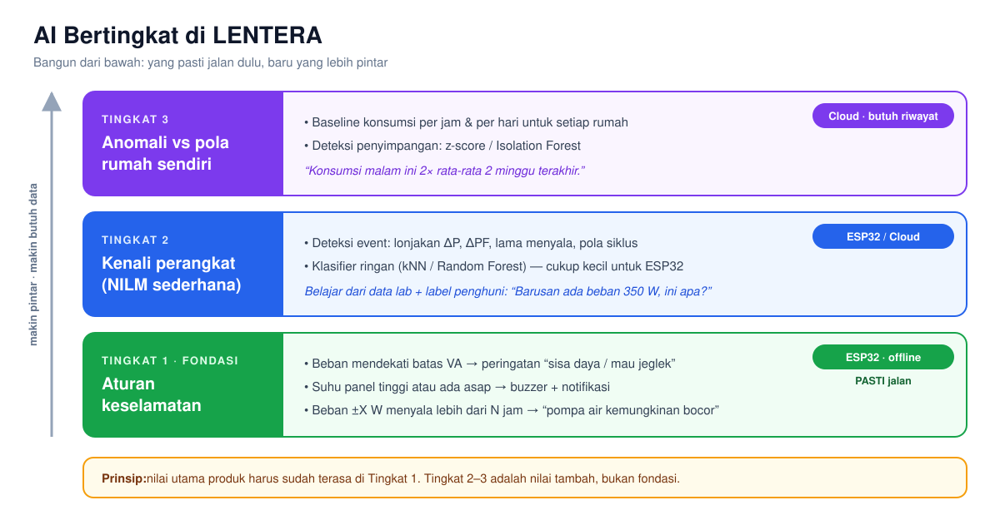
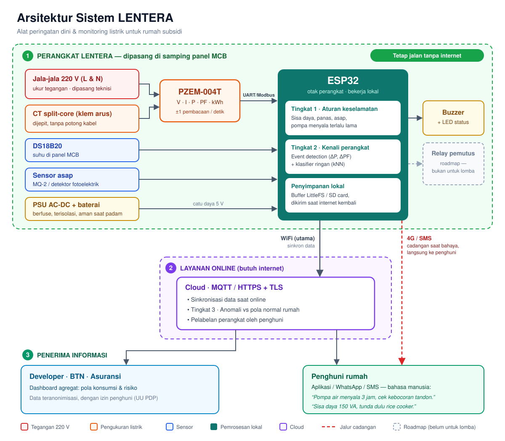

# Telaah Ide LENTERA — BTN Housingpreneur Batch 3 (2026)

**Tim:** Diftya Azzahra (Informatika A'25), Anugerah Fakhriza Reswara (Informatika A'25), Ghiyas (FEB)
**Kelompok/Kategori:** Business Ideation (Mahasiswa) → **Housing Innovation**
**Penelaah:** Anton Prafanto (calon dosen pembimbing)
**Tanggal:** 11 November 2026
**Rujukan:** *Guidebook BTN Housingpreneur Batch 3 2026* (34 halaman)

---

## 0. Ringkasan

**Ide ini layak dibawa dan saya bersedia membimbing**, dengan tiga syarat:

1. **Klaim teknis dibuat jujur.** Bagian "tidak memotong kabel, tidak perlu bongkar instalasi" dan "AI NILM membedakan semua perangkat" saat ini **berlebihan** dan akan mudah dipatahkan juri yang paham kelistrikan atau ML.
2. **Ruang lingkup dipersempit** untuk tahap pitch deck. Batas pendaftaran tinggal sekitar 19 hari, jadi fokuskan pada fitur yang bisa dibuktikan.
3. **Keselamatan kerja dulu.** Semua pengujian di jala-jala 220 V dilakukan di *test bench* lab yang terproteksi (MCB + RCD/ELCB), tidak di panel rumah sungguhan tanpa instalatir berlisensi.

Kekuatan terbesar ide ini justru **bukan NILM-nya**, tapi:

- **Masalah "jeglek" di rumah subsidi berdaya 900–1.300 VA.** Alat bisa menampilkan *sisa daya* dan memperingatkan sebelum MCB trip ("Jangan nyalakan rice cooker dulu, beban sudah 1.150 dari 1.300 VA").
- **Desain offline-first.** Ini pemikiran yang matang dan jarang dimiliki tim mahasiswa.
- **Hubungan ke ekosistem BTN** lewat asuransi kebakaran KPR, developer, dan program rumah subsidi.

---

## 1. Kecocokan dengan lomba

### 1.1 Kategori sudah tepat
Kategori **Housing Innovation** (Business Ideation) didefinisikan sebagai *"ide inovasi teknologi yang berkaitan dengan industri perumahan"*. Contoh karya di guidebook bahkan menyebut **"IoT untuk mengoptimalkan … konsumsi energi"** dan **"sistem sensor untuk memantau konsumsi … mendeteksi kebocoran"**. LENTERA masuk persis di wilayah ini.

### 1.2 Bobot penilaian Housing Innovation

| Kriteria | Bobot | Posisi LENTERA saat ini | Yang perlu ditunjukkan |
|---|---|---|---|
| Relevansi Masalah | 15% | Kuat secara intuisi, **lemah di data** | Data kebakaran akibat korsleting (Damkar/BNPB/berita lokal), data pelanggan 900/1.300 VA, keluhan nyata penghuni rumah subsidi |
| Orisinalitas & Kesiapan Wujud | 25% | Sedang. Energy monitor IoT sudah sering muncul di lomba | Pembeda: fokus rumah subsidi + daya kecil + offline + keselamatan, plus **prototipe yang benar-benar menyala** |
| Dampak (per satuan) | 25% | Belum terukur | Angka per rumah: kWh/rupiah yang bisa dihemat, jumlah jeglek yang dicegah, waktu deteksi bocor pompa |
| Skalabilitas & Replikasi | 25% | Potensi besar, belum dijelaskan | Biaya per unit, pola instalasi massal lewat developer, model data untuk BTN |
| Kelayakan Bisnis | 15% | Belum ada | Siapa yang membayar, harga, BOM, pembagian peran (di sini Ghiyas dari FEB jadi kunci) |

### 1.3 Hal administratif yang perlu dicek
- **Tim maksimal 5 orang termasuk dosen pembimbing.** Tiga mahasiswa + satu dosen = 4, aman.
- **Dokumen:** foto, KTP ketua, NPWP (jika ada), **KTM/Surat Keterangan Aktif dari Prodi**, **Pitch Deck maks. 7 slide**, dan **Pakta Integritas bermaterai**.
- **Timeline** (sesuai pembacaan saya atas halaman 7, mohon dicek ulang di website):
  - **Penutupan pendaftaran mahasiswa: 30 November**
  - Initial Screening: 30 Nov – 4 Des
  - Business & Idea Evaluation / Live Pitching: 7 – 11 Des
  - Inkubasi finalis: 4 – 8 Jan
  - Grand Judging: 13 – 14 Jan
  - Expo & Awarding: 15 – 17 Jan
- Finalis **wajib mengembangkan karya untuk pameran (Expo)**. Jadi kalau lolos, prototipe harus tampil rapi dan aman dipajang.

**Implikasinya:** tahap pertama hanya pitch deck. Prototipe penuh belum dibutuhkan hari ini, tapi **bukti awal** (foto/video alat membaca beban nyata) akan sangat menaikkan skor *Kesiapan Wujud*.

---

## 2. Jawaban atas 4 pertanyaan mahasiswa

### Q1. Realistis untuk prototipe mahasiswa Informatika dalam waktu singkat?

**Sebagian realistis, sebagian tidak.** Rinciannya:

| Komponen | Realistis dalam ~3 minggu? | Catatan |
|---|---|---|
| ESP32 membaca PZEM-004T (V, I, P, PF, kWh) | ✅ Ya, 1–3 hari | Library sudah matang (Modbus-RTU) |
| DS18B20 + MQ-2 + buzzer | ✅ Ya | MQ-2 perlu *warm-up* dan kalibrasi |
| Logging ke SD card + sinkron ke cloud | ✅ Ya | Perhatikan korupsi file saat listrik padam |
| Dashboard web/mobile sederhana | ✅ Ya | Firebase/Supabase/MQTT + web sederhana |
| Peringatan "sisa daya / mau jeglek" | ✅ Ya, **dan ini fitur paling bernilai** | Cukup logika, tanpa ML |
| Deteksi anomali berbasis aturan (pompa > X jam, beban malam > pola) | ✅ Ya | |
| Notifikasi bahasa manusia | ✅ Ya | Template teks, **tidak perlu LLM** |
| NILM untuk 3–5 perangkat dengan daya berbeda jelas | ⚠️ Bisa sebagai *proof of concept* | Lihat Q2 |
| NILM "umum" untuk rumah mana pun | ❌ Tidak realistis | Ini masalah riset terbuka, bahkan untuk produk komersial |
| Relay pemutus otomatis yang aman dan legal | ❌ Jangan di tahap ini | Lihat Q3 |
| SMS via GSM sebagai cadangan | ⚠️ Bisa, tapi perhatikan jaringan | Lihat Q3 |

### Q2. Apakah NILM bisa dilatih dengan data terbatas (5 perangkat di lab) dan dipertanggungjawabkan?

**Bisa, asalkan diposisikan dengan benar.** Ada keterbatasan fisik yang harus dipahami tim dulu.

**a) PZEM-004T adalah sensor frekuensi rendah.**
PZEM-004T memberi satu pembacaan V/I/P/PF kira-kira **sekali per detik**. Jadi yang mungkin dikerjakan adalah **NILM berbasis event pada daya nyata (P) dan power factor (PF)**: mendeteksi lonjakan/penurunan daya saat perangkat menyala atau mati, lalu mengenali "tanda tangan" lonjakan itu.

Yang **tidak** bisa dilakukan dengan PZEM:
- Analisis harmonik/bentuk gelombang. Produk NILM komersial (mis. Sense) mengambil sampel ratusan kHz sampai MHz untuk ini.
- Membedakan dua perangkat dengan daya mirip (charger HP vs lampu LED, kipas vs TV kecil).
- Mengenali beban variabel dengan andal (**AC inverter**, kulkas inverter), karena dayanya naik-turun halus tanpa "step" yang jelas.

**b) Kabar baiknya: rumah subsidi justru lebih cocok untuk NILM sederhana.**
Dengan daya 900–1.300 VA, jumlah perangkat besar yang menyala bersamaan **sedikit**: pompa air, rice cooker, setrika, kulkas, kadang AC ½ PK. Daya perangkat-perangkat ini cukup berbeda. Ini argumen bagus untuk pitch: *"Kami tidak mengklaim NILM umum; kami merancang NILM untuk profil beban rumah subsidi yang sederhana."*

**c) Cara supaya bisa dipertanggungjawabkan di depan juri:**
1. **Kumpulkan data yang benar.** Setiap perangkat dinyalakan sendiri, lalu **kombinasi** (pompa + kulkas, rice cooker + setrika, dst.), puluhan kali per kondisi, di waktu yang berbeda.
2. **Normalisasi tegangan.** Tegangan di rumah subsidi sering turun (mis. 190–200 V). Daya beban resistif ∝ V², jadi 400 W di lab bisa terbaca 330 W di rumah. Normalisasikan ke tegangan nominal.
3. **Model sederhana dan bisa dijelaskan.** Fitur: ΔP, ΔPF, durasi ON, pola siklus. Klasifier: kNN / Decision Tree / Random Forest. Model kecil ini **bisa jalan di ESP32** dan mudah dijelaskan ke juri. Hindari deep learning di tahap ini; datanya terlalu sedikit dan juri akan bertanya "datanya dari mana?".
4. **Split data yang jujur.** Pisahkan berdasarkan **sesi/waktu**, bukan acak per sampel, untuk menghindari *data leakage*. Lebih baik lagi kalau diuji dengan **unit berbeda dari jenis yang sama** (rice cooker merek lain).
5. **Laporkan metrik per perangkat:** precision/recall/F1 deteksi event dan confusion matrix. Tampilkan juga di mana model **gagal**. Juri lebih menghargai "akurasi 87% pada 5 perangkat di lab, gagal membedakan kipas dan TV" daripada "akurasi 99%".
6. **Label dari pengguna (semi-supervised).** Di lapangan, aplikasi bertanya *"Barusan ada beban 350 W menyala, ini apa?"*, lalu model belajar per rumah. Ini menjawab masalah data terbatas secara elegan.
7. **Kalau sempat, uji 1 minggu di 2–3 rumah nyata** (rumah anggota tim/kos), dipasang oleh instalatir. Data rumah nyata jauh lebih meyakinkan daripada data lab.
8. **Pembanding:** sebutkan dataset publik NILM frekuensi rendah (REDD, UK-DALE, REFIT) sebagai rujukan metode, tapi jelaskan bahwa profil beban Indonesia berbeda. Ini justru celah riset kalian.

**d) Bangun AI secara bertingkat:**

*Versi PNG untuk slide: [img/ai-bertingkat.png](img/ai-bertingkat.png)*

Contoh "pompa nyala 3 jam" **tidak perlu NILM yang canggih**. Begitu Tingkat 1 + Tingkat 2 sederhana jalan, fitur ini sudah bisa didemokan. Jangan sampai seluruh nilai produk bergantung pada bagian yang paling sulit.

### Q3. Kelemahan besar yang terlewat (keselamatan listrik & akurasi AI)

Ini bagian terpenting. Beberapa poin di bawah bisa menggugurkan proposal kalau ditanyakan juri dan tim tidak siap.

**🔴 1. Klaim "tidak memotong kabel, tidak perlu bongkar instalasi" tidak sepenuhnya benar.**
- PZEM-004T **wajib disambung langsung ke L dan N 220 V** untuk mengukur tegangan sekaligus menyalakan rangkaiannya. Yang non-invasif hanya bagian **arus** (CT).
- ESP32 juga butuh catu daya, umumnya modul AC-DC (mis. HLK-PM01) yang juga tersambung ke 220 V.
- CT bawaan PZEM-004T 100A umumnya **cincin tertutup**, jadi kabel harus dilepas untuk memasukkannya. Pakai varian **split-core** kalau ingin klaim "jepit".
- Sisi jaringan **sebelum MCB/kWh meter adalah milik PLN** dan tidak boleh diutak-atik. Pemasangan di sisi pelanggan tetap harus mengikuti **PUIL** dan sebaiknya oleh **instalatir bersertifikat**.

➡️ Ubah narasinya menjadi: *"Pemasangan ±15 menit oleh teknisi, tanpa mengubah jalur instalasi, sensor arus berupa klem split-core."*

**🔴 2. Relay pemutus otomatis: jangan di tahap ini.**
- Modul relay murah (SRD-05VDC, "10 A") **tidak layak** memutus beban utama rumah secara berulang. Kontak bisa lengket/menyambung permanen.
- Memasang relay seri di jalur utama **berarti memotong instalasi**, bertentangan dengan klaim di atas.
- **False positive** sangat mungkin terjadi. MQ-2 juga bereaksi terhadap **obat nyamuk bakar, asap masak, gas LPG, semprotan parfum**. Mematikan listrik satu rumah tengah malam karena obat nyamuk adalah UX yang buruk dan bisa berbahaya (lampu mati, ada yang memakai alat medis).
- Proteksi beban lebih **sudah dilakukan MCB**.

➡️ Untuk lomba: **alarm + notifikasi**, dan pemutusan otomatis ditaruh di **roadmap** dengan desain yang benar (shunt-trip pada MCB/RCBO bersertifikat, hanya pada kondisi gabungan suhu tinggi + arus tinggi, dipasang instalatir).

**🔴 3. Batas deteksi kebakaran harus dijelaskan dengan jujur.**
- Penyebab kebakaran listrik yang umum: **sambungan longgar, stopkontak bertumpuk, kabel non-SNI, busur api (arc fault)** di titik-titik yang **jauh dari panel**.
- DS18B20 di dekat MCB hanya mengukur suhu **di panel**. MQ-2 di dekat MCB hanya mencium asap **di situ**.
- Deteksi *arc fault* butuh sampling kHz–MHz, dan PZEM tidak bisa.
- MQ-2 **bukan detektor asap bersertifikat**. Sensor gas semikonduktor ini drift, sensitif kelembapan, dan butuh warm-up. Pertimbangkan **detektor asap fotoelektrik** sebagai modul tambahan.

➡️ Posisikan LENTERA sebagai **"sistem peringatan dini & pemantauan risiko"**, **bukan pengganti** MCB, RCD, atau detektor asap bersertifikat. Ini juga penting dari sisi **tanggung jawab hukum**: kalau alat diklaim "mencegah kebakaran" lalu terjadi kebakaran, klaim itu bisa berbalik.

**🟠 4. Housing PETG bukan material tahan api.**
PETG lebih tahan panas daripada PLA (Tg ±80 °C), tapi **tidak flame-retardant**. Untuk enclosure perangkat bertegangan 220 V di dekat panel, standar industri adalah material **UL94 V-0** (ABS/PC flame-retardant). Untuk prototipe/expo, PETG tidak masalah. Untuk produk, sebutkan bahwa versi produksi memakai enclosure V-0 atau box listrik standar. Juri teknik akan menghargai kesadaran ini.

**🟠 5. Saat listrik padam, alat ikut mati.**
Justru saat ada gangguan (MCB trip, PLN padam), alat kehilangan daya dan tidak bisa mengirim SMS. Tambahkan **baterai Li-ion kecil + charger + deteksi listrik padam** supaya alat sempat mengirim "Listrik rumah padam pukul 21.14, beban terakhir 1.280 VA (kemungkinan jeglek)".

**🟠 6. Modul GSM: cek jaringan dan biaya.**
- Jaringan 2G/3G di Indonesia sedang/sudah dimatikan bertahap. Modul 2G murah (SIM800L) berisiko tidak dapat sinyal. Pilih modul **4G LTE** (mis. keluarga SIM7600/A7670) dan uji di lokasi.
- Modul seluler menarik arus puncak ±2 A, jadi catu dayanya harus didesain.
- **Siapa yang membayar pulsa/kuota SIM?** Ini harus masuk model bisnis.

**🟠 7. Privasi data (UU PDP No. 27/2022).**
Data konsumsi listrik per menit bisa mengungkap **kapan rumah kosong**, jam tidur, dan kebiasaan penghuni. Kalau data dikirim ke BTN/developer, perlu **persetujuan penghuni**, agregasi/anonimisasi, dan keamanan (TLS, autentikasi perangkat). Sebutkan di pitch, karena ini menunjukkan kedewasaan desain.

**🟡 8. Akurasi pengukuran & teknis lainnya.**
- PZEM-004T bukan alat ukur tersertifikasi. Akurasinya cukup untuk monitoring, **tidak** untuk tagihan. Jangan klaim "lebih akurat dari meteran PLN".
- SD card rawan korup saat listrik padam mendadak. Gunakan sistem file yang tahan (LittleFS) atau buffer di flash, lalu tulis berkala.
- Perhatikan isolasi antara sisi 220 V dan sisi ESP32 (jarak rambat/creepage di PCB, fuse di input).

### Q4. Layak dibawa ke lomba dan diterapkan di perumahan subsidi?

**Layak dibawa ke lomba: ya.** Masalahnya nyata, kategorinya pas, timnya lengkap (2 Informatika + 1 FEB), dan alat sudah tersedia di kampus.

**Layak diterapkan di perumahan subsidi: ya, dengan model bisnis yang tepat.** Pertanyaan pertama juri pasti: **"Penghuni MBR mau bayar berapa?"** Jawabannya hampir pasti **bukan penghuni yang membayar penuh**. Opsi yang bisa dieksplorasi Ghiyas:

| Pembayar | Alasan mereka mau membayar |
|---|---|
| **Developer** | Nilai jual "rumah aman & cerdas", mengurangi komplain pasca-serah-terima ("listrik sering jeglek"), data kualitas instalasi kontraktor |
| **Asuransi kebakaran KPR** | KPR umumnya mensyaratkan asuransi kebakaran. Deteksi dini dapat menekan klaim. **Ini sinergi paling kuat dengan ekosistem BTN** |
| **BTN** | Indikator risiko agunan, nilai tambah program KPR subsidi, data untuk program edukasi hemat energi |
| **Penghuni** | Model langganan murah setelah tahun pertama (opsional) |

**Wajib ada di deck: estimasi BOM per unit.** Kisaran kasar harga eceran (silakan verifikasi):

| Komponen | Kisaran (Rp) |
|---|---|
| ESP32 DevKit | 60–90 rb |
| PZEM-004T + CT split-core | 120–200 rb |
| DS18B20 + MQ-2 (atau detektor asap) | 30–150 rb |
| Modul 4G LTE | 200–400 rb |
| PSU AC-DC + baterai + proteksi | 60–120 rb |
| SD/penyimpanan, buzzer, PCB, enclosure | 60–150 rb |
| **Total prototipe** | **± 530 rb – 1,1 jt** |

Lalu tunjukkan jalur turunnya biaya pada produksi massal (PCB sendiri, chip energy-metering langsung seperti HLW8032/BL0937 alih-alih modul PZEM, membeli dalam volume). Target realistis: **< Rp400 rb per unit** di skala ribuan rumah. Tambahkan juga **varian tanpa modul seluler** (WiFi saja + SMS opsional).

---

## 3. Rekomendasi arah (scope) untuk tiap tahap

### Tahap 1 — Pitch deck (sampai ±30 November)
Fokus pada **3 fitur inti yang pasti bisa dibuktikan**:
1. **Sisa daya & pencegah jeglek** (real-time, offline)
2. **Peringatan panas/asap di panel** (offline, buzzer + notifikasi)
3. **Deteksi anomali pemakaian** (pompa menyala terus, beban malam tidak wajar), dengan pengenalan 3–5 perangkat sebagai *proof of concept* NILM

Plus **foto/video prototipe awal** di test bench lab. Relay pemutus, GSM, dan NILM penuh masuk **roadmap**.

### Tahap 2 — Jika lolos ke Live Pitching (7–11 Des)
- Data NILM dari lab + metrik jujur (confusion matrix)
- Dashboard berjalan, demo live: nyalakan rice cooker → notifikasi muncul
- Jawaban siap untuk pertanyaan keselamatan (bagian Q3)

### Tahap 3 — Jika masuk Grand Judging & Expo (Jan)
- Uji lapangan 2–3 rumah nyata (dipasang instalatir), minimal 1 minggu
- Enclosure rapi untuk pameran, model bisnis dengan simulasi angka
- Modul baterai + 4G jika sempat

### Pemetaan ke 7 slide (struktur wajib Business Ideation)

| Slide | Isi wajib (guidebook) | Isi LENTERA |
|---|---|---|
| 1 | Inspirasi & Latar Belakang | Cerita nyata penghuni rumah subsidi: jeglek, takut korsleting, tagihan tidak terkendali |
| 2 | Permasalahan, Kebutuhan & Peluang | **Data**: kebakaran akibat listrik, jumlah pelanggan 900/1.300 VA, jumlah rumah subsidi/FLPP per tahun |
| 3 | Ide & Gagasan Utama | LENTERA: alat kecil di samping MCB + AI bertingkat + offline-first |
| 4 | Nilai Tambah & Kesesuaian Kategori | Pembeda vs smart meter/smart plug biasa; pemetaan ke 5 kriteria Housing Innovation |
| 5 | Visualisasi & Konsep Desain | Diagram arsitektur, render/foto housing, mockup notifikasi "bahasa manusia" |
| 6 | Fungsi, Estetika, Sustainability & Keunikan | Hemat energi (sustainability), keselamatan, desain housing, harga |
| 7 | Konsep Pengembangan & Implementasi | Roadmap (lab → pilot → developer mitra → skala), model bisnis, BOM, sinergi BTN |

---

## 4. Sketsa arsitektur yang saya sarankan

*Versi PNG untuk slide: [img/arsitektur-lentera.png](img/arsitektur-lentera.png)*

**Cara membaca diagram:**
1. **Zona hijau (perangkat)** tetap bekerja tanpa internet. Semua fungsi keselamatan ada di sini.
2. **Zona ungu (online)** hanya dipakai saat ada internet, untuk sinkronisasi dan analisis lanjutan.
3. **Garis merah putus-putus (4G/SMS)** adalah jalur cadangan. Peringatan bahaya langsung dikirim ke penghuni tanpa lewat cloud.
4. **Kotak abu-abu putus-putus (relay pemutus)** masuk roadmap, bukan fitur untuk lomba.

---

## 5. Usulan balasan ke mahasiswa (WhatsApp)

> Waalaikumsalam Diftya. Terima kasih sudah menghubungi saya dan menjelaskan idenya dengan rapi. Saya bersedia jadi dosen pembimbing tim kalian.
>
> Pendapat jujur saya: ide LENTERA **layak dibawa** ke kategori Housing Innovation. Masalahnya nyata, desain offline-first-nya sudah matang, dan tim kalian lengkap dengan adanya Ghiyas dari FEB untuk sisi bisnis.
>
> Ada beberapa catatan penting yang perlu kita perbaiki sebelum pitch deck:
> 1. **Klaim "tidak memotong kabel"** perlu direvisi. PZEM-004T tetap harus tersambung ke L-N 220 V untuk mengukur tegangan, jadi pemasangannya tetap butuh teknisi.
> 2. **Relay pemutus otomatis** sebaiknya masuk roadmap dulu. Untuk lomba kita fokus ke alarm dan notifikasi. MQ-2 juga bisa terpicu obat nyamuk/asap masak, jadi risiko salah mematikan listrik cukup besar.
> 3. **NILM** bisa dipertanggungjawabkan kalau kita posisikan sebagai *proof of concept* untuk beberapa perangkat dengan daya yang berbeda jelas. Laporkan metriknya dengan jujur, termasuk saat model gagal. Tidak perlu mengklaim mengenali semua perangkat.
> 4. Fitur yang menurut saya **paling kuat** justru peringatan **"sisa daya / mau jeglek"** untuk rumah 900–1.300 VA. Ini simpel, langsung terasa manfaatnya, dan tidak bergantung pada AI yang rumit.
> 5. Untuk sisi bisnis, coba Ghiyas eksplorasi siapa yang membayar: developer, asuransi kebakaran KPR, atau BTN, beserta estimasi biaya per unit.
>
> Satu hal penting: **semua pengujian di listrik 220 V dilakukan di test bench lab yang ada MCB dan ELCB-nya**, jangan langsung di panel rumah tanpa teknisi.
>
> Silakan atur waktu 15–30 menit minggu ini untuk menunjukkan sketsa arsitektur dan prototipenya. Mohon bawa: (a) diagram arsitektur, (b) foto/video alat yang sudah membaca beban, (c) draft 7 slide sesuai struktur guidebook. Batas pendaftaran 30 November, jadi kita perlu bergerak cepat.
>
> Semangat ya, saya tunggu kabarnya.

---

## 6. Agenda pertemuan 15–30 menit

1. **(5')** Demo singkat: alat membaca V/I/P/PF dari 1–2 beban di test bench
2. **(5')** Review arsitektur: posisi alat, catu daya, isolasi, offline vs online
3. **(5')** Kesepakatan scope pitch deck: 3 fitur inti, dan apa saja yang masuk roadmap
4. **(5')** Rencana data NILM: perangkat apa, berapa kali ulang, kombinasi, metrik
5. **(5')** Pembagian tugas: hardware & firmware / AI & data / bisnis & deck (Ghiyas)
6. **(5')** Timeline mundur dari 30 November dan jadwal bimbingan berikutnya

---

*Catatan: kisaran harga komponen dan status jaringan seluler adalah perkiraan umum dan perlu diverifikasi tim. Rujukan aturan (PUIL, UU PDP) disebut sebagai arah. Detail kepatuhan sebaiknya dikonsultasikan dengan pihak yang berwenang/instalatir bersertifikat.*
